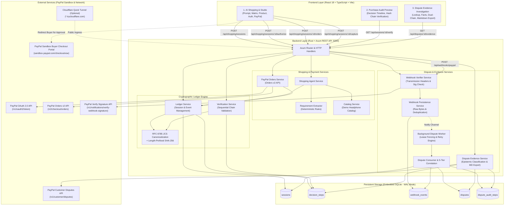

# AgentAudit

> **Trust, Accountability and Dispute Evidence for AI-Powered Commerce.**

[](#5-technology-stack)
[](#5-technology-stack)
[](#5-technology-stack)
[](#7-paypal-sandbox-setup)
[](#10-security-trust-model-and-limitations)

AgentAudit is an open-source, audit-grade commerce platform built in Rust and React for the PayPal AI ecosystem. It pairs an autonomous AI shopping agent with an append-only, tamper-evident cryptographic decision ledger, genuine PayPal Sandbox Orders v2 checkout, cryptographic webhook signature verification, deterministic dispute-to-purchase correlation, and automated dispute evidence brief generation.

---

## Table of Contents

1. [Problem and Solution](#1-problem-and-solution)
2. [Architecture Diagram](#2-architecture-diagram)
3. [Key Features](#3-key-features)
4. [End-to-End User Journey](#4-end-to-end-user-journey)
5. [Technology Stack](#5-technology-stack)
6. [Quick Start](#6-quick-start)
7. [PayPal Sandbox Setup](#7-paypal-sandbox-setup)
8. [Testing Commands](#8-testing-commands)
9. [API Reference Pointer](#9-api-reference-pointer)
10. [Security, Trust Model and Limitations](#10-security-trust-model-and-limitations)

---

## 1. Problem and Solution

### The Accountability Gap in Autonomous AI Commerce
As AI agents evolve from conversational assistants to autonomous financial delegates, they introduce a critical accountability gap:
* **Unbounded Agency**: Autonomous agents risk purchasing products that exceed user budgets or deviate from user intent without explicit, verifiable consent.
* **Ephemeral Reasoning**: When an agent selects product A over product B, standard database logs record only the final transaction. The agent's requirements extraction, candidate comparisons, and rejection reasons are lost.
* **Vulnerable Audit Trails**: Standard database records can be silently updated, deleted, or disputed after the fact, making them unsuitable as legal or financial proof.
* **The Dispute Dilemma**: When a customer files a dispute (e.g., claiming an unauthorized purchase or item not as described), merchants lack a structured, mathematically provable record explaining *why* the agent made the purchase, *what* exact authorization the customer granted, and *how* payment settled.

### The AgentAudit Solution
AgentAudit provides mathematical accountability across the complete purchase and dispute lifecycle:
1. **Deterministic Evaluation**: Natural language shopping requests are parsed into structured constraints and evaluated against a catalog with recorded rejection rationales.
2. **Explicit Authorization Boundary**: The backend enforces a cryptographic invariant: no PayPal order can be created or captured without an explicit customer authorization step recorded in the ledger with a declared spending ceiling.
3. **Cryptographic Sealing**: Every decision event is canonicalized using RFC 8785 (JCS) and chained using SHA-256. Upon payment capture, the session root hash is permanently frozen.
4. **Signed Dispute Ingress & Correlation**: PayPal dispute webhooks are verified via RSA-SHA256 signatures, preserved in raw byte format, and deterministically correlated to the original purchase session using a 5-tier matching engine.
5. **Audit-Grade Evidence Briefs**: Automatically generates structured JSON and Markdown evidence briefs categorizing facts into epistemic categories (`VERIFIED_FACT`, `RECORDED_PAYPAL_DATA`, `DETERMINISTIC_INFERENCE`, `UNAVAILABLE_EVIDENCE`) to streamline dispute resolution.

---

## 2. Architecture Diagram



---

## 3. Key Features

* **Deterministic AI Shopping Agent**: Extracts budget, category, battery life, features, and brand preferences from natural language prompts. Evaluates catalog candidates and records structured rejection reasons (`CANDIDATE_REJECTED`) for non-compliant products.
* **Explicit Customer Authorization Gate**: Enforces a strict cryptographic invariant: PayPal orders cannot be created or captured without an explicit customer authorization step recorded in the ledger with a declared spending ceiling.
* **PayPal Orders v2 Integration**: Creates Sandbox checkout orders with `intent: CAPTURE`, links them via `custom_id`, verifies buyer approval authoritatively server-side via the PayPal Orders v2 API, and captures payment.
* **RFC 8785 Cryptographic Ledger**: Every decision step is canonicalized using RFC 8785 (JCS) and chained using length-prefixed SHA-256. Upon payment capture, the session root hash is frozen.
* **Signed Webhook Ingress & Verification**: Validates incoming PayPal webhook transmission signatures against PayPal's verification service using raw request bytes, and persists events idempotently.
* **Autonomous Worker Fencing & Correlation**: An autonomous background worker leases pending events with UUID fencing tokens, reclaims abandoned leases, and correlates disputes to purchase sessions using a 5-tier matching engine.
* **Audit-Grade Dispute Evidence Briefs**: Generates factual JSON and Markdown evidence briefs categorizing facts into epistemic categories (`VERIFIED_FACT`, `RECORDED_PAYPAL_DATA`, `DETERMINISTIC_INFERENCE`, `UNAVAILABLE_EVIDENCE`) to provide clear documentation for dispute resolution.

---

## 4. End-to-End User Journey

```
 1. Customer enters natural language shopping prompt
    └─ Example: "Find wireless noise-canceling headphones under $100 with 30h battery"
 2. System extracts structured constraints deterministically
    └─ Category: headphones | Max Budget: $100.00 | Battery: 30h | Features: [noise-canceling, wireless]
 3. Demo catalog candidates are evaluated
    └─ 8 candidate products retrieved from the embedded demo catalog
 4. Non-compliant candidates are rejected with explicit reasons
    └─ Sony WH-1000XM5: Rejected (Price $399.99 exceeds budget $100.00)
    └─ Bose QC45: Rejected (Price $329.00 exceeds budget $100.00)
    └─ Sennheiser HD 450BT: Rejected (Price $129.95 exceeds budget $100.00)
 5. Agent selects recommended product
    └─ Anker Soundcore Life Q30 ($79.99, 40h battery, ANC, in-stock)
 6. Customer reviews selection and explicitly authorizes purchase
    └─ Confirms product SKU and authorizes maximum spending ceiling ($100.00)
    └─ Appends PURCHASE_AUTHORIZED event to cryptographic ledger
 7. Backend creates PayPal Sandbox Order
    └─ Creates Orders v2 order with intent: CAPTURE and custom_id: <session_id>
    └─ Returns PayPal approval URL
 8. Customer approves order in PayPal Sandbox portal
    └─ Buyer logs into personal Sandbox account and authorizes payment
 9. Backend authoritatively checks PayPal order status
    └─ Queries GET /v2/checkout/orders/<order_id> to verify status == "APPROVED"
10. Backend captures payment
    └─ Executes POST /v2/checkout/orders/<order_id>/capture
11. Ledger records payment capture and finalizes
    └─ Appends PAYPAL_PAYMENT_CAPTURED event with capture ID and amount
    └─ Seals session and freezes final root SHA-256 hash
12. Cryptographic verification audits purchase chain
    └─ Sequential validation from GENESIS_HASH (64 zeros) to sealed root hash
13. PayPal dispute webhook is received and verified
    └─ Ingests CUSTOMER.DISPUTE.CREATED at POST /api/webhooks/paypal
    └─ Verifies RSA signature against PayPal API; persists raw payload
14. Background worker correlates dispute to purchase session
    └─ 5-tier correlation matches seller_transaction_id to recorded capture ID
    └─ Anchors dispute audit chain to purchase session root hash
15. Evidence brief is generated and exported
    └─ Produces audit-grade JSON and Markdown evidence brief with facts and rebuttals
```

---

## 5. Technology Stack

* **Backend**:
  * [Rust](https://www.rust-lang.org/) (2021 edition, stable toolchain)
  * [Axum](https://github.com/tokio-rs/axum) (v0.7) & [Tokio](https://tokio.rs/) (v1.x)
  * [SQLx](https://github.com/launchbadge/sqlx) (v0.9) with embedded SQLite (WAL mode, foreign keys, immutability trigger)
  * [sha2](https://github.com/RustCrypto/hashes) (v0.11) & [hex](https://github.com/KokaKiwi/rust-hex) (v0.4)
  * [serde_jcs](https://crates.io/crates/serde_jcs) (v0.2 - RFC 8785 JSON Canonicalization Scheme)
  * [reqwest](https://github.com/seanmonstar/reqwest) (v0.12, JSON, rustls-tls)
  * [chrono](https://github.com/chronotope/chrono) (v0.4) & [uuid](https://github.com/uuid-rs/uuid) (v1)
  * [dotenvy](https://github.com/allan2/dotenvy) (v0.15) & [tracing](https://github.com/tokio-rs/tracing) (v0.1)
* **Frontend**:
  * [React](https://react.dev/) (v18.3.1) & [React-DOM](https://react.dev/) (v18.3.1)
  * [TypeScript](https://www.typescriptlang.org/) (v5.6.3)
  * [Vite](https://vitejs.dev/) (v6.0.1) with `@vitejs/plugin-react` (v4.3.4)
  * Custom responsive CSS with accessible Unicode glyphs
* **Infrastructure**:
  * PayPal Developer Sandbox (Orders v2 API, Disputes API, Webhook Signature Verification API)
  * Cloudflare Quick Tunnel (`cloudflared`) *(Optional for local webhook testing)*

---

## 6. Quick Start

### Prerequisites
* **Rust**: 1.75+ (`rustup update stable`)
* **Node.js & npm**: Node.js v18+ and npm v9+
* **PayPal Developer Sandbox**: Business and Personal accounts from [developer.paypal.com](https://developer.paypal.com/)

### Environment Setup
```bash
# Clone the repository
git clone https://github.com/your-org/paypalagent.git
cd paypalagent

# Copy environment configuration
cp .env.example .env
```

Configure `.env` with your Sandbox credentials:
```ini
PORT=5000
RUST_LOG=agentic_commerce=info,tower_http=info,axum=info
DATABASE_URL=sqlite:data/agentic_commerce.db?mode=rwc
PAYPAL_BASE_URL=https://api-m.sandbox.paypal.com
PAYPAL_CLIENT_ID=your_paypal_sandbox_client_id_here
PAYPAL_CLIENT_SECRET=your_paypal_sandbox_client_secret_here
PAYPAL_WEBHOOK_ID=your_paypal_sandbox_webhook_id_here
```
*Note: Database tables and indexes initialize automatically on startup via transactional migrations in `src/db/mod.rs`.*

### One-Command Development Startup
Launch backend and frontend concurrently:
```bash
./scripts/dev.sh
```

To enable a Cloudflare Quick Tunnel for live PayPal webhook ingress:
```bash
./scripts/dev.sh --tunnel
```

* **Frontend UI**: `http://127.0.0.1:5173`
* **Backend API**: `http://127.0.0.1:5000`
* **Health Check**: `http://127.0.0.1:5000/health`
* **Local Webhook Endpoint**: `http://127.0.0.1:5000/api/webhooks/paypal`

### Manual Startup (Fallback)
* **Terminal 1 (Backend)**: `cargo run`
* **Terminal 2 (Frontend)**: `npm run dev --prefix frontend`

---

## 7. PayPal Sandbox Setup

AgentAudit integrates exclusively with PayPal's Sandbox environment. **Sandbox transactions do not move real currency.**

1. **Create Sandbox Accounts**:
   * Log into [developer.paypal.com](https://developer.paypal.com/).
   * Verify you have one **Business Account** (merchant) and one **Personal Account** (buyer).
2. **Create REST API App**:
   * Under **Apps & Credentials (Sandbox)**, create an app named `AgentAudit-Sandbox`.
   * Enable the **Customer disputes** add-on feature.
   * Copy the **Client ID** and **Client Secret** into `.env`.
3. **Register Webhook Endpoint**:
   * Add a webhook pointing to your public HTTPS address (e.g., Cloudflare Tunnel: `https://<subdomain>.trycloudflare.com/api/webhooks/paypal`).
   * Subscribe to event types:
     * `Customer dispute created` (`CUSTOMER.DISPUTE.CREATED`)
     * `Customer dispute resolved` (`CUSTOMER.DISPUTE.RESOLVED`)
     * `Customer dispute updated` (`CUSTOMER.DISPUTE.UPDATED`)
     * `Payment capture completed` (`PAYMENT.CAPTURE.COMPLETED`)
   * Copy the generated **Webhook ID** into `PAYPAL_WEBHOOK_ID` in `.env`.
4. **Approval Flow**:
   * During checkout in the frontend, follow the generated Sandbox approval URL.
   * Log in with your **Personal Buyer Account** to approve the order, then return to AgentAudit to capture payment.

---

## 8. Testing Commands

### Offline Unit & Integration Tests
All business logic, cryptographic hash chaining, and SQLite operations can be tested completely offline without external internet or PayPal credentials:

```bash
# Run all unit tests in the library crate (74 tests)
cargo test --lib

# Run specific integration test suites
cargo test --test ledger_tests                # RFC 8785 hashing, tamper detection, finalization
cargo test --test shopping_and_paypal_tests   # Catalog search, requirements, authorization, capture
cargo test --test dispute_consumer_tests      # Worker lease fencing, retry backoff, event processing
cargo test --test dispute_correlation_tests   # 5-tier deterministic correlation hierarchy
cargo test --test dispute_service_tests       # Immutability triggers and out-of-order dispute updates
cargo test --test dispute_worker_tests        # Background worker concurrency, drainage, cancellation
cargo test --test webhook_http_tests          # Webhook HTTP ingress, payload size limits, status codes
cargo test --test webhook_persistence_tests   # Raw byte storage, duplicate deduplication, divergence
cargo test --test webhook_tests               # Signature verification client and cert URL validation
cargo test --test dispute_evidence_tests      # Epistemic category rules and evidence brief generation
cargo test --test dispute_evidence_api_tests  # Evidence REST API endpoints (JSON and Markdown)
cargo test --test oauth_tests                 # PayPal OAuth token caching and expiry refresh
cargo test --test dispute_webhook_e2e_tests   # End-to-end ingress through dual-chain verification
```

### Frontend Build Verification
```bash
npm run build --prefix frontend
```

### Note on Live Sandbox Tests
The test file `tests/live_sandbox_and_agent_e2e.rs` contains live integration tests (`test_live_paypal_sandbox_oauth_and_order_creation`, `test_live_paypal_sandbox_webhook_lookup`) designed to connect directly to `https://api-m.sandbox.paypal.com`. These tests require active internet connectivity and valid Sandbox credentials in `.env`.

---

## 9. API Reference Pointer

All backend endpoints are served under `http://127.0.0.1:5000`:

* **Health & Auth**:
  * `GET /health`: Operational health check.
  * `GET /api/paypal/auth-check`: Verifies PayPal OAuth connectivity and token caching.
* **Shopping & Checkout**:
  * `GET /api/catalog/products`: Lists products in the demo catalog.
  * `POST /api/shopping/sessions`: Initiates shopping prompt analysis and candidate evaluation.
  * `GET /api/shopping/sessions/:session_id`: Retrieves shopping session details.
  * `POST /api/shopping/sessions/:session_id/authorize`: Submits customer purchase authorization.
  * `POST /api/shopping/sessions/:session_id/orders`: Creates PayPal Orders v2 Sandbox order.
  * `GET /api/shopping/sessions/:session_id/order-status`: Queries live PayPal order status.
  * `POST /api/shopping/sessions/:session_id/capture`: Captures payment and seals root hash.
  * `GET /api/shopping/checkout/success` & `.../cancel`: PayPal browser return endpoints.
* **Cryptographic Ledger**:
  * `POST /api/sessions`: Initializes an audit session.
  * `GET /api/sessions/:session_id`: Retrieves session metadata.
  * `POST /api/sessions/:session_id/events`: Appends a custom decision step.
  * `GET /api/sessions/:session_id/events`: Retrieves all decision steps in sequence.
  * `GET /api/sessions/:session_id/verify`: Executes sequential cryptographic hash-chain verification.
  * `POST /api/sessions/:session_id/finalize`: Finalizes session and seals root hash.
* **Webhook Ingress**:
  * `POST /api/webhooks/paypal`: Ingests, verifies, and persists PayPal webhooks (max 256 KB).
* **Dispute Evidence**:
  * `GET /api/disputes/:dispute_id/evidence`: Returns structured evidence brief JSON.
  * `GET /api/disputes/:dispute_id/evidence/markdown`: Returns formatted Markdown evidence brief.

---

## 10. Security, Trust Model and Limitations

### Security Controls
1. **Server-Side Secret Isolation**: PayPal Client Secrets, OAuth access tokens, and webhook verification signatures are strictly confined to the backend. The React frontend never receives credentials.
2. **Explicit Customer Authorization**: The backend enforces a hard authorization gate: an agent cannot create or capture a PayPal order without a preceding `PURCHASE_AUTHORIZED` step signed off by the customer.
3. **Spending Ceiling Validation**: Even if an agent recommends an item, order creation is rejected if the authorized spending limit is less than the item price.
4. **Server-Side Approval Verification**: Payment capture is blocked until the backend queries PayPal Orders v2 API and confirms `status == "APPROVED"`.
5. **Pre-Persistence Signature Verification**: Webhooks are never persisted to SQLite before PayPal's cryptographic signature verification succeeds.
6. **Raw Request Preservation**: The exact raw request bytes delivered by PayPal are preserved and hashed to ensure complete non-repudiation of webhook events.
7. **Worker Lease Fencing**: Dispute processing relies on UUID fencing tokens and atomic `BEGIN IMMEDIATE` transactions. Stale workers fenced out by timeouts cannot commit mutations.
8. **Genesis Anchor Immutability Trigger**: An SQLite trigger (`trg_protect_dispute_genesis_anchor`) prevents updates to dispute genesis anchors once recorded.

### What the Cryptographic Hash Chain Proves — And What It Does Not
* **What It Proves**:
  * Proves that recorded events occurred in the exact stated sequence without retroactive modification, deletion, or injection.
  * Proves that the dispute audit chain is anchored to the exact root hash produced when the purchase settled.
* **Honest Limitations**:
  * **Local Database Scope**: The hash chain is stored in local SQLite. An attacker with root file-system access could alter historical rows and recompute the entire chain. It is not an externally distributed or public blockchain.
  * **No Physical Proof**: The hash chain verifies agent decisions and customer consent; it does **not** prove physical parcel delivery, postal carrier handoff, or product condition upon unboxing.
  * **No Biometric Proof**: Authorization records confirm that the browser session approved the transaction; they do not biometrically verify the physical individual operating the device.

### Project Limitations
* **Deterministic Demo Catalog**: The product catalog is an in-memory collection of 8 headphone models designed for reproducible testing. It is not connected to a live merchant inventory feed.
* **PayPal Sandbox Only**: The platform is configured for PayPal Sandbox. Live real-money production settlement requires production credentials, PCI compliance review, and business verification.
* **Embedded SQLite**: SQLite is lightweight and self-contained; high-concurrency production deployments may benefit from migration to PostgreSQL.
* **Single Merchant Model**: The current implementation supports a single merchant Sandbox configuration rather than multi-tenant merchant onboarding.

---

## Contribution and License

Contributions, issue reports, and feedback are welcome. Please open an issue or pull request on GitHub.

Licensing for AgentAudit has not yet been specified. All rights are reserved by the original authors pending public license selection.
